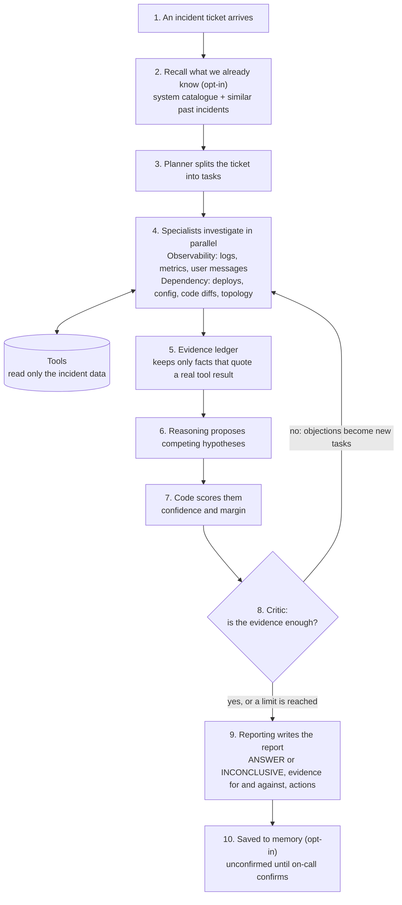
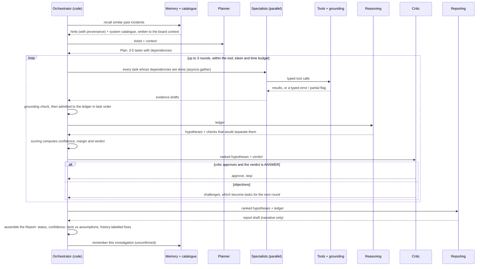

# Architecture

## System overview



Read top to bottom: one investigation. Agents share one typed state, the blackboard, instead of
passing text to each other. Steps 5 and 7 are plain code, not model calls, so the model cannot
invent evidence or pick its own confidence. The answer key exists only for the evaluation harness;
nothing in this flow can read it.

The tools can read `data.json` only. The answer key is a separate file that only `tests/eval/` opens, and
import-linter plus a gate check fail the build if runtime code references it.

**Knowledge and memory: what the team knows before it looks at telemetry.** Both are opt-in, so the
evaluated default runs without them.
- **System catalogue** (`incident.knowledge`, `scenarios/catalog/*.json`). It describes the system
  as it normally is: services, who calls whom, queues, the metrics each service exports, code
  modules, tables and config. It is written ahead of time, never from the incident's data, so it
  saves discovery calls without hinting at what broke.
- **Incident memory** (`incident.memory`). It is a property graph of past investigations in SQLite.
  `recall()` finds similar past incidents, either by keyword or by hybrid retrieval
  (`incident.retrieval`: BM25 and bge-small embeddings fused by reciprocal rank, then a
  cross-encoder rerank).

How they enter a run:
- `prime()` writes the catalogue and the past incidents into the board's context, which starts
  every agent prompt.
- The past incidents are also added to the history that `search_incidents` serves, as hints
  labelled with their provenance (confirmed by on-call, unconfirmed, or rejected).
- A hint is never evidence about the current incident. It cannot change the status. The only thing
  it adds is a confirmed past fix, offered as an action labelled "from history".
- After the run, `remember()` stores the investigation as unconfirmed, and `Memory.confirm(...)`
  records on-call's verdict.

### Message-level data (v2 app world)

When a dataset carries per-message records and git history, three more tools are offered. Which tools
are offered depends only on what the data contains, never on the scenario. `message_funnel` counts
messages received, replied, failed, dead-lettered, answered despite a tool failure, and thumbs-down,
in time windows. `conversation_trace` returns single WhatsApp messages end to end: prompt version,
context, tool calls with their errors, the answer and feedback. `get_code_change` returns the commit
behind a deploy, with its CI result and diff. They let the agents connect "the bot gave a wrong
answer" to a prompt release, a config commit, a queue or an external limit.

## How the agents coordinate

Agents never exchange free text. They read and write one shared, serialisable **blackboard**
(`state.Board`) through typed messages (`messages.py`):

| Message | From → to | Effect |
|---|---|---|
| `Plan` / `PlanTask` | Orchestrator → board | creates the task DAG (with dependencies) |
| `SpecialistResult` / `EvidenceDraft` | Observability, Dependency → ledger | each FACT is verified against the stored raw tool result before it is admitted |
| `ReasoningResult` / `HypothesisDraft` | Reasoning → board | hypotheses cite ledger ids; `discriminating_checks` become new tasks |
| `CriticVerdict` / `ChallengeDraft` | Critic → board | each challenge becomes a task for a named specialist; unresolved ones lower confidence |
| `ReportDraft` → `Report` | Reporting → code | narrative only; ranking, confidence and status are computed by code |

The collaboration is genuine because the Critic's output changes which tools run next, and the
Reasoning agent's "what evidence would separate these hypotheses" does too.



## Why the answer can be trusted (and when it declines to answer)

* **Grounding.** A FACT must quote a tool result: numbers match exactly and at least 90% of the words
  must appear. Invented evidence is rejected and counted (the "hallucinated evidence" metric).
  Partial, truncated and past-incident sources are down-weighted. Claims that cite nothing are dropped.
* **Confidence is code, not opinion.** `score = Σ reliability(supporting)/k − 1.25·(Σ reliability(contradicting)
  + 0.3·Σ reliability(uncorroborated))`, where k is the number of active hypotheses citing the same
  fact; `confidence = score / (score + 2)`, capped by 0.9 − 0.1 per unresolved evidence gap (never below 0.5).
  "Contradicting" means refuting; "uncorroborated" (absence, an undocumented link, timing within
  resolution) counts for 30% (calibrated offline).
* **INCONCLUSIVE is a first-class outcome.** ANSWER needs confidence ≥ 0.40, a lead of ≥ 0.25 over
  rivals that cannot be true at the same time, and a leader whose contradiction stays below 75% of
  its support. Independent concurrent causes are marked `compatible_with` so they do not compete; a
  near-synonym on the same component (a cause label sharing a word) is the same answer, not a rival.
* **Facts and assumptions are separated by construction**: a claim is a FACT only if everything it cites is a FACT.

## Reliability and recovery

| Failure | What happens |
|---|---|
| Tool timeout / unavailable | bounded retries with exponential backoff; if still failing, a structural gap that caps confidence |
| Truncated / partial result | flagged in the result; evidence from it is down-weighted; the agent is told to narrow or retry |
| Invalid tool input | typed non-retryable error listing valid names; does not consume the tool budget |
| Agent crash / invalid JSON | one repair attempt; a task is retried at most twice, then recorded as a gap and the run continues |
| Reasoning or Reporting fails | the run still ends with a valid Report (INCONCLUSIVE if nothing is supported) |
| Budget (tool calls, tokens, time, rounds) | hard stop; the report states why it stopped early |
| Crash mid-run | the board is checkpointed to disk after each wave; `resume=True` skips finished work |
| Prompt injection in logs | tool output is delimited as untrusted data and agents are instructed never to follow it |

## Observability of the investigator itself

Every run writes `trace.jsonl` (plan, each tool call with attempts and flags, each task outcome,
each round's verdict, final stats) and `board.json`. The final report carries tool calls, attempts,
LLM calls, tokens and wall time, and `stats.models`: the model id that actually answered each call,
as reported by the backend (tapes record it too). Routing by role, pinned ids (`incident.llm.ROLE_MODEL`,
override with `LLM_MODEL_<ROLE>` / `LLM_EFFORT_<ROLE>`):

| role | model | effort |
|---|---|---|
| planner, observability, dependency (tool loops), judge | claude-sonnet-5-5 | medium |
| reasoning, critic, reporting, single-agent baseline | claude-opus-5-5 | medium |

Results recorded before 2026-10-26 02:30 IST used Haiku for the tool loops and the judge and a Sonnet
alias elsewhere (exact versions were not recorded then); they are a different configuration.

## How ADK is used (an audit, including what we deliberately do not use)

| ADK feature | Used? | Why |
|---|---|---|
| Custom `BaseAgent` (`InvestigationAgent`) | yes | The orchestrator's control flow (task waves, critic loop, budgets, termination) must be deterministic code, not a model decision. |
| `LlmAgent` per role | yes | Planner, Observability, Dependency, Reasoning, Critic, Reporting and the baseline each run as an isolated ADK agent with its own session. |
| Custom `BaseLlm` (`ProtocolLlm`) | yes | Lets the Claude Code login act as the model, with record/replay/fake backends behind one interface. |
| Custom `BaseTool` with a JSON-schema declaration | yes | Tool inputs are the same pydantic models the tools validate with, so the model sees exactly what is enforced. |
| `RunConfig(max_llm_calls)` | yes | A hard per-agent bound on model calls (it stopped a runaway loop during development). |
| `ParallelAgent` / `SequentialAgent` / `LoopAgent` | no | They are fixed pipelines. Our parallelism is task-graph waves (`asyncio.gather`) applied in task order, which keeps evidence ids deterministic and replayable. |
| Callbacks (before/after model or tool) | no | Tracing, budgets and gap accounting live in our own tool wrapper and trace, so they are identical under every backend. |
| `ContextCacheConfig` / prompt caching | not with Claude Code | See below. |
| Native `Claude` model class (`google.adk.models.anthropic_llm`) | not used, documented | The right production backend when an API key exists: native function calling and explicit cache breakpoints (tools, system prompt, latest turn, 5-minute or 1-hour lifetime). `LLM_BACKEND=api` is reserved for it and not implemented, because this project runs on a Claude Code login. |

**Prompt caching, as measured.** Claude Code applies caching itself. An
identical prefix is read from cache, but each follow-up turn we send is a longer single text blob,
so only the fixed system prompt (about 1.2k tokens) is reused and the new content is written again.
Per-run sessions would write only the delta, but for our one- or two-turn tool loops the saving is
small, so we did not add them. The larger levers are output size and digesting data before the model
sees it (the lean profile).

## Optional subsystems (opt-in, so the evaluated default is unchanged)

**Lean profile** (`Limits.lean`, `--lean`): adds two deterministic digest tools (`get_anomalies`:
earliest sustained metric deviations across all services and queues; `get_log_patterns`: patterns
new since the baseline), shorter evidence limits in the prompts, a de-duplicated quote-free ledger
for Reasoning, Critic and Reporting, and memoised tool calls. Offline, with no model, the anomaly
timeline puts the true culprit first in 13 of the 19 scenarios s01-s19 and in the top 3 in 17.

**Incident memory** (`incident.memory`): a property graph in SQLite (incident, service, cause,
change nodes; AFFECTED, ROOT_CAUSE, ON, PRECEDED_BY, CALLS edges). Past incidents return as hints
through the history channel the agents already treat as weak evidence, labelled with provenance
(confirmed by on-call, agent-concluded and unconfirmed, previously inconclusive, or REJECTED by
on-call), so a wrong past conclusion cannot quietly become a known cause. Stored text is redacted.
For evaluation, exclude the incident under test (leave-one-out). The schema maps onto Neo4j/FalkorDB.

**Knowledge base** (`incident.knowledge`; pass `memory=` and/or `catalogue=` to `investigate`,
`investigate_baseline` or `investigate_hybrid`): what the team knows before it looks at telemetry, always context and never
evidence.

```
 Memory (past investigations + on-call verdicts)      scenarios/catalog/*.json (src/scripts/build_catalog.py)
        | recall: similar incidents, with provenance           | services, calls, queues, normal metrics,
        v                                                      v code modules, DB tables, config keys
 board.past ---------------------> board.context <------------ Catalogue (from the BASE world + repo)
        |                               | shown to planner, specialists, reasoning, baseline
        |                               v
        |                        investigation (unchanged: evidence, scoring, critic)
        v
 report: after the verdict, a CONFIRMED past incident on the leading component with a cause label
 sharing a word adds "[from history: <id>] <fix>" as a follow_up action (source: history), citing a
 history ASSUMPTION it adds to the ledger. It can never change the status or any confidence.
```

The catalogue is built from the system as it normally runs, never from an incident's data (a test
checks that fault-only metrics are absent), so it saves discovery calls without hinting at the
cause; it can be stale, so the agents still verify topology with tools. Live evaluation of both
parts: docs/RESULTS.md ("Knowledge base").

**Mock infrastructure** (`tests/mockworld/`): local stand-ins that speak the real wire formats of Datadog
(logs search with cursors, metrics query), GitHub (deployments, runs, commits), GCP Cloud Audit Logs
and CloudFormation, served from any scenario, with optional rate-limit and outage injection. The
adapters are tested against them for exact parity. `python src/scripts/demo_mock_infra.py` prints the
wire traffic and the parity check.
