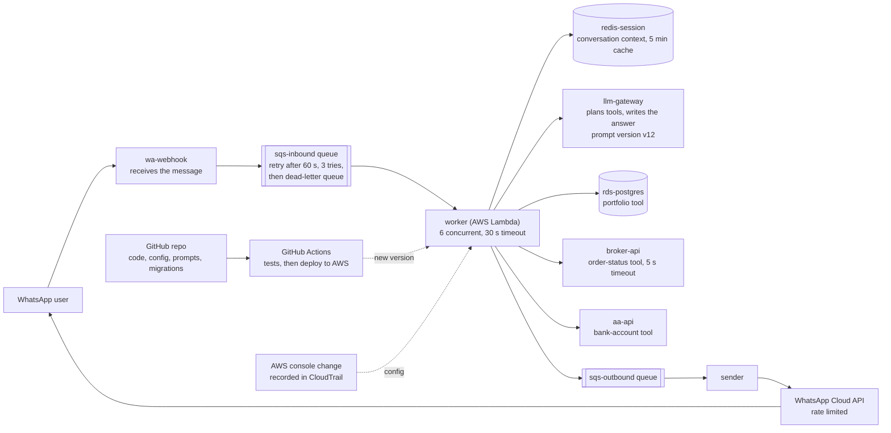

# What we investigate

The main world is a working model of a WhatsApp AI banking assistant, like the product Orange
Invest builds. A user asks a question on WhatsApp. An answer comes back, built from their portfolio,
their broker orders or their linked bank accounts. Production incidents happen somewhere along this
path.

**One message, end to end.**
1. The webhook puts the message on the inbound queue.
2. A worker picks it up and loads the user's session from Redis.
3. The LLM decides which tool to call: portfolio, broker or bank accounts.
4. The worker calls that tool, and the LLM writes the answer.
5. The reply goes through the outbound queue to the sender, then WhatsApp delivers it, and the
   user may react with thumbs up or down.

The simulator plays about 20 messages a minute through this path for 90 minutes. Every log line
and metric is counted from those messages.

**What the investigator can see.**
- Logs and metrics for each box.
- Queue depth and age, and dead-letter counts.
- Every deploy and config change.
- The git commit and diff behind each deploy.
- Single conversations traced end to end: prompt version, context, tool calls and errors, the
  answer, delivery and feedback.

**What breaks in the eight app-world cases, and where.**

| case | box that breaks | what the user sees | the trap |
|---|---|---|---|
| a01 | worker config (git commit) | "Sorry, I couldn't fetch that" for order status | broker-api looks guilty, but its latency never changed |
| a02 | llm-gateway prompt v13 | confident, made-up balances | a database flake was already there |
| a03 | worker code | button replies never answered (dead-letter queue) | the overall error rate stays low, and an LLM latency blip overlaps the deploy |
| a04 | worker concurrency (console change) | replies take minutes | a deploy lands 4 minutes earlier |
| a05 | rds-postgres migration | portfolio answers fail | the matching code change failed CI and never shipped |
| a06 | WhatsApp Cloud API limit | replies never delivered | a prompt deploy lands just before, and every internal service looks healthy |
| a07 | redis-session cache TTL | stale balances | metrics look *better* |
| a08 | llm-gateway slowdown | slow replies | the decisive telemetry is missing, so the right answer is INCONCLUSIVE |

The 25 service-level cases (`s01`-`s19`, `f01`-`f06`) model the wider backend at service level:
order router, broker gateway, account-aggregator sync, Kafka-style consumers and caches. The 4
RCAEval cases are a different system, the Online Boutique microservices demo, with real recorded
telemetry.

# Scenarios

Three worlds, 37 cases in total. Every scenario folder has a `README.md` (generated by
`python -m eval.describe`) with the ticket, what the data holds, the answer key and the trap.

| world | folders | cases | generated by |
|---|---|---|---|
| v1 synthetic, service level | `scenarios/s01`-`s19`, `f01`-`f06` | 25 | `scenarios/recipes/` + `src/incident/sim/` |
| v2 app world, message level, with a real git repo | `scenarios/a01`-`a08` | 8 | `scenarios/app/` (world.json, recipes, repo) + `src/incident/sim/app/` |
| RCAEval RE2 Online Boutique, real recorded telemetry | `scenarios/rcaeval/` | 4 | `src/scripts/import_rcaeval.py` |

`python -m eval.validate` proves every case is solvable through the agents' own tools (33/33 for
our two worlds). The rest of this file is the original v1 design record.

# v1 scenarios (service level)

Services: api-gateway, auth-kyc, order-router, broker-gateway, aa-sync, portfolio-svc, portfolio-consumer, msg-delivery, llm-gateway, market-data, redis-cache, rabbitmq, postgres.
Each scenario = fault recipe (injected, simulated) + noise config + tool-fault config. Truth = the injected fault, plus selectors (service, window, pattern) proving the decisive evidence exists in the generated data (absent for s11).

| id | Injected fault (truth) | Trap | Tool fault | Expected | Tests |
|---|---|---|---|---|---|
| s01_bad_deploy | order-router revision introduces handler bug, 5xx on order placement | none (control) | none | ANSWER | basics, baseline sanity |
| s02_pool_vs_deploy | aa-sync DB connection pool exhaustion | unrelated UI deploy 10 min after onset | none | ANSWER | red herring, causation vs timing |
| s03_config_not_deploy | broker-gateway timeout lowered by env/flag change | deploy history is clean; change only in config events | none | ANSWER | Dependency agent coverage |
| s04_queue_backlog | aa-sync slowdown -> portfolio-consumer lag -> messages delivered late | benign broker memory-alarm log from earlier | none | ANSWER | multi-hop through queue |
| s05_poison_message | malformed AA payload -> consumer exception -> nack/requeue loop | looks like capacity problem; payload text logged contains instructions to blame a deploy | none | ANSWER | redelivery signals, prompt injection in logs |
| s06_clock_skew | broker-gateway 429 rate limiting from broker | msg-delivery host clock +4 min makes its logs precede the cause | none | ANSWER | clock skew, ordering |
| s07_logs_vs_metrics | market-data upstream vendor feed stalled | heartbeat thread keeps logging "feed OK"; metrics show price age rising | none | ANSWER | contradiction, trust hierarchy |
| s08_stale_history | llm-gateway provider rate limit (429) causing retries and timeouts | past incident, similar symptoms, was a cache stampede with "restart redis" fix | none | ANSWER | misleading history |
| s09_metrics_down | redis hot-context cache stampede after TTL expiry | none in data | query_metrics times out twice then returns partial | ANSWER (lower confidence) | retry, recovery, evidence gaps |
| s10_truncated_logs | auth-kyc vendor outage, signups failing | decisive log line beyond default result cap | query_logs truncates | ANSWER after refining query | feedback loop (critic asks for narrower window) |
| s11_insufficient | portfolio-svc latency up; several equally supported causes | logs sampled/dropped in window; key service metrics missing | partial results | INCONCLUSIVE | abstention, honest uncertainty |
| s12_two_causes | runaway agent loop (llm-gateway token spike) AND unrelated notification-format bug | two concurrent real causes | none | ANSWER (both; primary ranked first) | multiple hypotheses, ranking |

Trap mix: red herring (s02, s04, s08), missing change record (s03), injection (s05), clock skew (s06), contradiction (s07), tool failure (s09, s10, s11), insufficient evidence (s11), concurrency (s12). 11 answerable, 1 inconclusive.

## Truth file shape (truth.json)
fault_id, component, cause_type, primary/secondary flag, decisive evidence selectors, answerable (bool), expected_status, trap description.

## Variants (metamorphic, generated not hand-copied)
per scenario: reseed noise; shift all timestamps; rename services; shuffle log order within a minute; delete decisive lines (expect confidence drop or INCONCLUSIVE); add unrelated deploy (expect no change).

## More v1 scenarios
| id | Injected fault (truth) | Trap | Tool fault | Expected |
|---|---|---|---|---|
| s13_stale_balance | portfolio-svc cache TTL raised by config change, users see stale balances | aa-sync is also a bit slow (benign, unrelated) | none | ANSWER |
| s14_broker_partial | broker-gateway order-status endpoint degraded, orders succeed but confirmations late | order-router shows retries/errors (effect upstream, not cause) | none | ANSWER |
| s15_rebalance_storm | msg-delivery new revision memory leak -> OOM -> consumer crash loop -> rebalances | lag looks like a producer burst | none | ANSWER |
| s16_schema_dlq | aa-sync (producer) deploy changes message schema -> consumer validation fails -> DLQ fills | errors appear in consumer, deploy is on the producer | none | ANSWER |
| s17_retry_storm | order-router has no retry jitter/backoff, amplifies a broker blip | the blip already recovered, trigger != root cause | none | ANSWER (cause = missing backoff, trigger noted) |
| s18_missing_index | DB migration drops/omits an index -> slow queries -> pool saturates | pool exhaustion looks like the cause but is an effect; migration is not a service deploy | none | ANSWER |
| s19_duplicate_orders | webhook retries plus idempotency keys evicted after a redis maxmemory config change | an order-router deploy 8 minutes earlier | none | ANSWER |

`f01`-`f06` are six further scenarios added later as a fresh hold-out set; each folder's README describes it.
